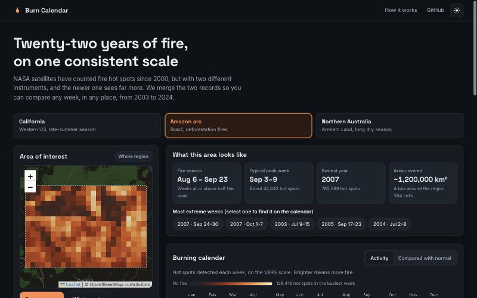

# Burn Calendar

**Live app: https://tttamannaanand.github.io/burn-calendar/**

A consistent, 22-year record of satellite-detected fires. It harmonizes NASA's two active-fire hot-spot records, MODIS (2000s) and VIIRS (2012 on), into one VIIRS-equivalent series (2003-2024), then turns it into a year-by-week burning calendar for any area you draw. Built for the NASA Space Apps Challenge 2026 challenge *Harmonization of MODIS and VIIRS Hot Spots*.



## What it shows
- A summary for any region or area: fire season (weeks at or above 50% of the seasonal peak), typical peak week, busiest year and the most extreme weeks.
- A year-by-week burning calendar, as raw activity or compared with normal for that week, with plain-language tooltips.
- A typical year with its normal range, and the full record of raw MODIS against the harmonized series.
- "How far can you trust this?": the held-out validation as simple bars.
- Region tabs, preset areas, or draw your own box. The URL records the view, so you can share it as a link.
- Light and dark themes, a phone layout, and keyboard support for the calendar (arrow keys).

## Results (held-out 2019-2024, against real VIIRS)

| Region | Raw MODIS total | Harmonized total | Weekly error (raw to harmonized) |
|---|---|---|---|
| California, USA | 0.23x | 0.88x | 1298 to 381 |
| Amazon arc, Brazil | 0.27x | 1.01x | 4645 to 811 |
| Northern Australia | 0.22x | 0.99x | 3483 to 484 |

1.00x means unbiased against VIIRS. See [SUBMISSION.md](SUBMISSION.md) for the method, limitations and alternatives we tested.

## FAQ
**Why not just use VIIRS?** It only starts in 2012, so it cannot show decades of change. MODIS goes back further but sees about a quarter of what VIIRS sees.

**Why quantile mapping?** It matches the whole distribution of weekly cell counts (not just the average) and was best on weekly accuracy in all three regions. Alternatives (conditional-mean calibration, an intensity-dependent correction) fixed California's total at the cost of weekly accuracy, or gained little. Details are in the write-up.

**Why is California 12% low?** Mostly the extreme 2020 and 2021 seasons. Only 3 of 124,488 held-out cell-weeks exceed the training range, so it is not simple extrapolation. In the 2012-2018 training years the MODIS/VIIRS relationship barely depends on fire intensity, so the shift cannot be learned from them. The production series fits the mapping on all overlap years, so it does see 2020-2021. The held-out number is therefore a pessimistic estimate.

**Why start in 2003?** Aqua MODIS began mid-2002. Earlier years have roughly half the detections, which would distort the seasonal baseline.

**Which fires are counted?** FIRMS standard-processing archives: MODIS (Terra and Aqua) and VIIRS Suomi-NPP, presumed vegetation fires only (type 0), nominal or high confidence.

**Is it global?** No. Three test regions at 0.5 degree resolution. Hot-spot counts only; Fire Radiative Power is not harmonized yet.

## Run it yourself
```
python3 -m venv .venv && .venv/bin/pip install numpy pandas requests
cd pipeline
FIRMS_MAP_KEY=your_key ../.venv/bin/python fetch_firms.py      # real data; free key at firms.modaps.eosdis.nasa.gov/api/map_key
REAL_DATA=1 ../.venv/bin/python harmonize.py                    # writes docs/data/*.json
cd ../docs && python3 -m http.server 8765                       # open http://localhost:8765
```
`pipeline/make_synthetic.py` generates synthetic data for development only; the app shows a warning banner for it. Downloading takes roughly an hour per region because of FIRMS rate limits.

## Layout
- `pipeline/` data download, harmonization and validation
- `docs/` the static web app and its pre-aggregated data (served by GitHub Pages)

## Data
NASA FIRMS (https://firms.modaps.eosdis.nasa.gov). Map tiles: OpenStreetMap contributors.
